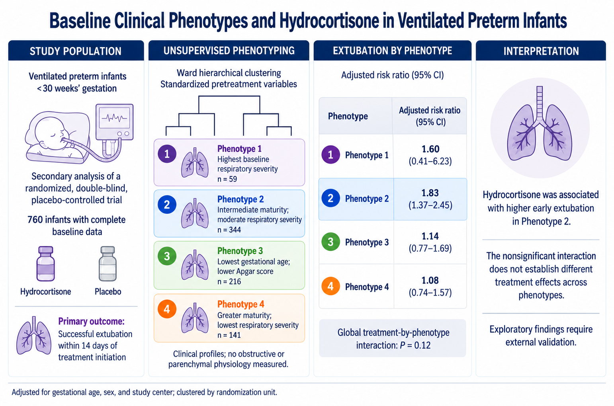

# Baseline Phenotypes and Short-Term Respiratory Outcomes After Hydrocortisone in Ventilated Extremely Preterm Infants

  

## Overview
Bronchopulmonary dysplasia (BPD) remains a major cause of morbidity in extremely preterm infants. Hydrocortisone is frequently used to facilitate extubation, but randomized trials have shown inconsistent benefits, suggesting potential heterogeneity in treatment response.

## Objective
To identify clinically relevant baseline phenotypes in ventilator-dependent preterm infants and evaluate whether outcomes and associations with hydrocortisone vary across phenotypes.

## Baseline Phenotype Characteristics 
| Phenotype | n infants | Characteristics |
|-----------|-----------|-----------------|
| 1 | 59 | Highest respiratory severity at treatment initiation |
| 2 | 344 | Infants with intermediate maturity and moderate respiratory disease |
| 3 | 216 | Most immature infants and was distinguished by lower Apgar scores and substantial ventilatory support requirements |
| 4 | 141 | Most mature infants with the lowest baseline respiratory severity and highest birth weights |

## Baseline Characteristics by Derived Phenotype
| Baseline characteristics | Overall  (n=760) | Phenotype 1  (n=59) | Phenotype 2  (n=344) | Phenotype 3  (n=216) | Phenotype 4  (n=141) |
|--------------------------|------------------|---------------------|----------------------|----------------------|----------------------|
| Gestational age (Weeks) | 25.0 (24.0,26.0) | 26.0 (25.0,27.0) | 24.0 (24.0,25.0) | 24.0 (23.0,25.0) | 27.0 (26.0,27.0) |
| Birth weight (g) | 690.0 (600.0,800.0) | 790.0 (670.0,900.0) | 680.0 (602.5,760.0) | 615.5 (535.0,703.5) | 886.0 (770.0,1,000.0) |
| 5-minute Apgar score | 6.0 (4.0,7.0) | 7.0 (6.0,8.0) | 7.0 (6.0,8.0) | 3.0 (2.0,4.0) | 7.0 (6.0,8.0) |
| Age at randomization (Days) | 21.0 (18.0,25.0) | 17.0 (15.0,19.0) | 22.0 (19.0,25.0) | 21.0 (17.5,24.0) | 20.0 (18.0,26.0) |
| Baseline respiratory severity (MAP x FiO2 x 100) | 480.0 (341.0,727.0) | 1,015.2 (900.0,1,200.0) | 450.0 (322.7,660.0) | 510.4 (356.4,845.0) | 400.0 (323.0,506.0) |
| Female | 365/760 (48%) | 22/59 (37%) | 179/344 (52%) | 116/216 (54%) | 48/141 (34%) |
| Multiple gestation | 189/760 (25%) | 18/59 (31%) | 88/344 (26%) | 42/216 (19%) | 41/141 (29%) |
| Antenatal steroid exposure | 671/757 (89%) | 55/59 (93%) | 303/343 (88%) | 189/214 (88%) | 124/141 (88%) |
|------|-------------------|-----------------|----------------------|----------------------|----------------------|----------------------|
| Race |                   |                 |                      |                      |                      |                      |
|------|-------------------|-----------------|----------------------|----------------------|----------------------|----------------------|
